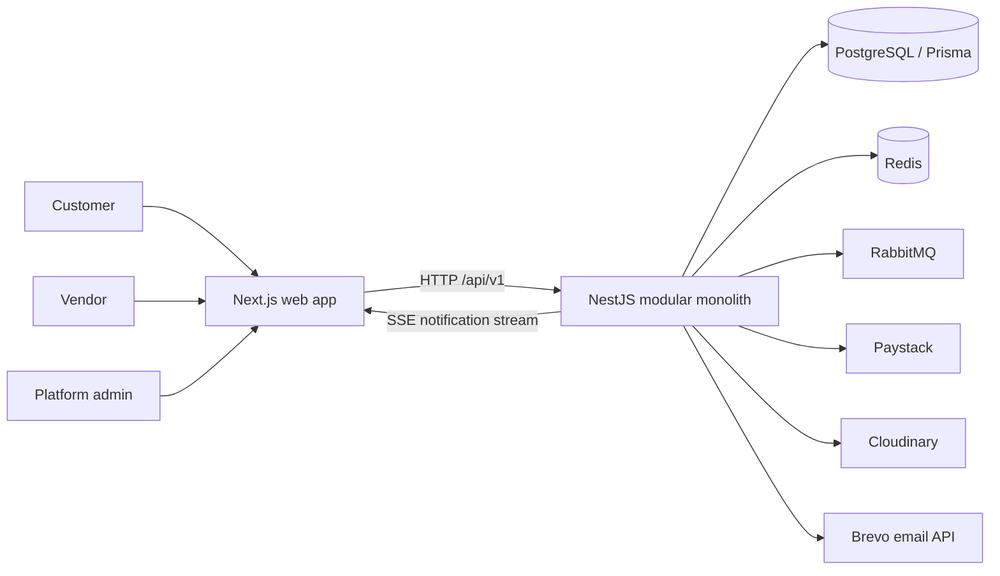
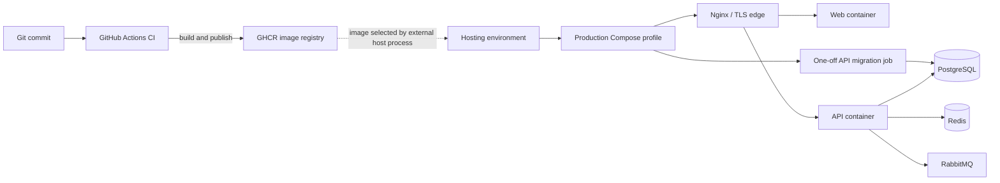
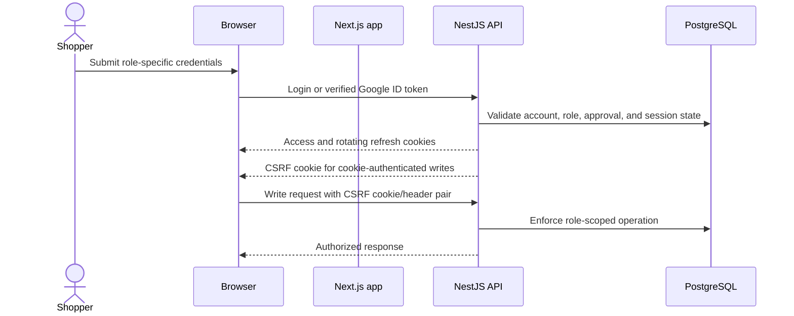
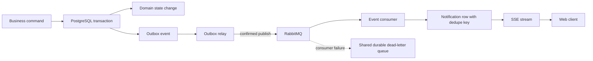
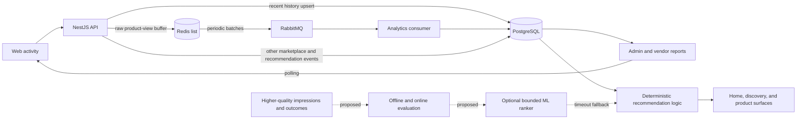

# NUTS Architecture Diagrams

This page is the visual architecture reference. Captions identify the view and link to the domain guide with implementation details. **Solid lines show current behavior; dashed lines show an external boundary or a proposed path.** The diagrams are versioned with the repository; update the relevant view when its implementation changes.

## 1. System context and runtime — current



The API modules share one process and commerce database. See the [platform guide](../platform/runtime-and-data.md) and [backend module map](../reference/backend-module-map.md).

## 2. Deployment and release boundary — current



The repository workflow publishes images; host rollout and live verification are external operational steps. See [release and recovery](../operations/runbooks/release-and-recovery.md).

## 3. Browser identity and session boundary — current



Vendor sessions require an active, approved vendor. See [Identity, Accounts, and Security](../domains/identity-and-account-security.md).

## 4. Checkout, payment, and refund lifecycle — current

```mermaid
sequenceDiagram
    actor Shopper
    participant Web as Web app
    participant API as API
    participant DB as PostgreSQL
    participant PSP as Paystack
    Shopper->>Web: Submit checkout
    Web->>API: Create order with idempotency key
    API->>DB: Revalidate price and stock; persist order and inventory change
    API-->>Web: Order and payment initialization
    Web->>API: Start payment
    API->>PSP: Initialize payment
    PSP-->>Web: Provider checkout
    PSP->>API: Signed payment webhook
    API->>PSP: Verify provider transaction and amount
    API->>DB: Settle payment and advance valid order state
    API->>DB: Credit vendor earnings as pending
    Shopper->>API: Request full refund
    API->>DB: Persist refund attempt and stable provider reference
    API->>PSP: Request refund
    PSP->>API: Signed refund event or reconciliation result
    API->>DB: On refund.processed, reverse settlement and restore stock
```

Payment confirmation and refunds have explicit failure and reconciliation paths. See [Shopping, Promotions, and Orders](../domains/shopping-promotions-and-orders.md) and [Payments and Financial Ledger](../domains/payments-and-financial-ledger.md).

## 5. Transactional outbox and notification delivery — current



The outbox covers selected business events and delivers at least once. Consumer failure and outbox publish failure are separate recovery stages. See [Notifications and Asynchronous Delivery](../domains/notifications-and-async-delivery.md).

## 6. Analytics and recommendation signals — current and proposed



The Redis/RabbitMQ path applies to product views; other event types can write directly to PostgreSQL. The ML path is proposed and has no trained model in the current system. See [Analytics and Measurement](../domains/analytics-and-measurement.md), [Discovery and Personalization](../domains/discovery-and-personalization.md), and the [recommendation scaling plan](../scaling/recommendations.md).

## Related references

- [Domain guides](../domains/README.md)
- [Platform Runtime and Data](../platform/runtime-and-data.md)
- [Architecture decisions](adr/README.md)
